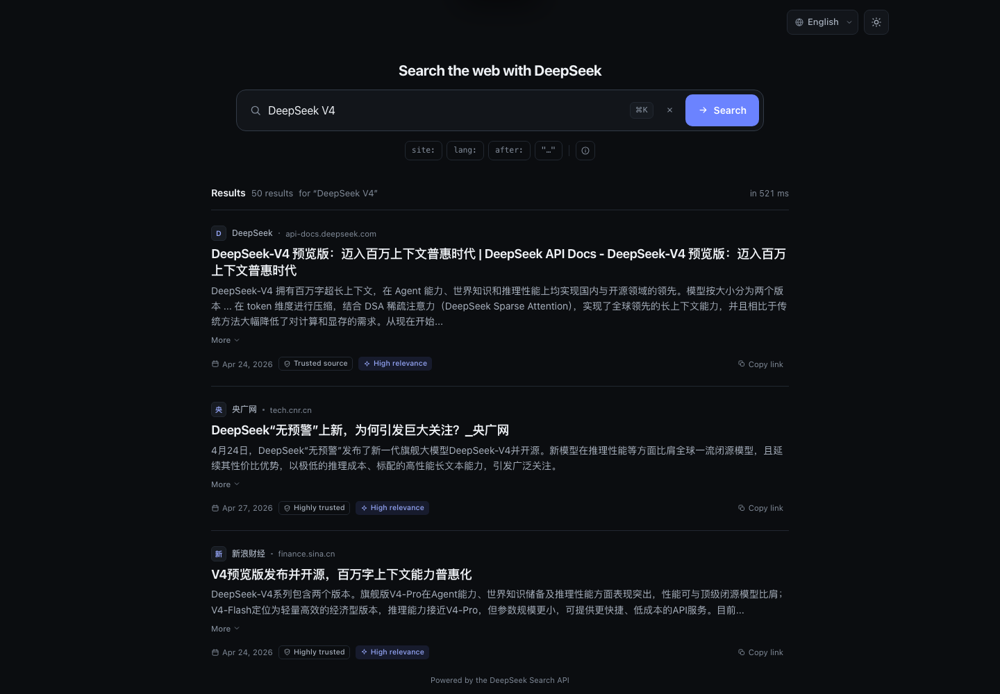

# DeepSeek Search

A small, focused web search app powered by the [DeepSeek Search API](https://api-docs.deepseek.com/zh-cn/guides/search). It pairs a clean, minimal interface with a tiny dependency-free Node server that keeps your API key off the client.



## Highlights

- **Real web results** — title, snippet, long summary, publication date, site metadata, rerank score and authority from DeepSeek Search.
- **Clean, flat design** — no fake window chrome or glass effects: a quiet toolbar, generous whitespace, clear typography, and a divider-based results list, in refined light and dark themes.
- **Light / dark mode** — follows your system by default, with a one-click toggle that remembers your choice.
- **Four languages** — 简体中文, English, 日本語, 한국어, with locale-aware dates and a language switcher that remembers your choice.
- **Small and clear** — one search field, useful query operators, keyboard shortcuts, and 10-results-per-page pagination (up to 50 results fetched per search, so paging is instant).
- **Private by design** — the API key lives only in the server process; the browser talks to a local `/api/search` proxy.
- **Zero dependencies** — no npm packages, no build step. Node.js 20+ is enough.

## Quick start

```bash
# 1. Prerequisite: Node.js 20+ (no npm dependencies to install)

# 2. Configure your DeepSeek API key
cp .env.example .env
# open .env and set DEEPSEEK_API_KEY=sk-...

# 3. Run
npm start
```

Open **http://127.0.0.1:3000**.

### Try it without an API key

```bash
MOCK_SEARCH=1 npm start
```

Demo mode serves a fixed set of realistic sample results locally and never calls the DeepSeek API, so every query returns the same results. A "Demo data" badge and an explanatory note are shown in the interface. Add `DEEPSEEK_API_KEY` to `.env` and run live mode to get real, query-specific results.

## Configuration

All configuration is optional except the API key.

| Variable | Default | Description |
| --- | --- | --- |
| `DEEPSEEK_API_KEY` | — | Your DeepSeek API key. Required for live search. |
| `PORT` | `3000` | HTTP port. |
| `HOST` | `127.0.0.1` | Bind address. Use `0.0.0.0` to expose on your LAN (not recommended without a reverse proxy). |
| `MOCK_SEARCH` | `0` | Set to `1` to serve demo results without API calls. |
| `RATE_LIMIT_PER_MIN` | `60` | Per-IP search limit, to protect your API key from accidental loops. |
| `CACHE_TTL_SECONDS` | `60` | In-memory cache for identical searches. |
| `UPSTREAM_TIMEOUT_MS` | `20000` | DeepSeek API request timeout. |
| `DEEPSEEK_API_BASE` | `https://api.deepseek.com` | Override the API base URL (useful for testing). |

`.env`, `.env.local` and `.env.*.local` are git-ignored. If both files exist, `.env.local` overrides `.env`; real process environment variables take precedence over both. Configuration is read at startup, so **restart the server after changing `.env`**.

## Search syntax

The query field accepts DeepSeek Search operators. Use the in-app help button for a quick reference.

| Operator | Example | Purpose |
| --- | --- | --- |
| `site:` | `DeepSeek site:github.com` | Restrict to a site. Chain with `OR`. |
| `-site:` | `DeepSeek -site:example.com` | Exclude a site. |
| `-` | `DeepSeek -ads` | Exclude a word. |
| `-"..."` | `DeepSeek -"release notes"` | Exclude a phrase. |
| `"..."` | `"exact phrase"` | Match a phrase exactly. |
| `lang:` | `DeepSeek lang:zh,en` | Restrict result languages. |
| `after:` / `before:` | `DeepSeek after:2025-01-01` | Restrict by publication date. |

## How it works

```
Browser  ──POST /api/search──▶  Node server  ──Bearer auth──▶  api.deepseek.com/v1/tools/search
   ▲                                │
   └───────── static UI ◀───────────┘  (key stays here)
```

- `server.js` serves `public/` and proxies `POST /api/search` to `https://api.deepseek.com/v1/tools/search`.
- Search requests send `need_content: false`; the UI uses the API's `snippet` and `summary` fields, which keeps responses small and fast.
- `GET /api/health` reports whether an API key is configured and whether demo mode is active. It never returns the key.
- Identical queries are cached for 60 seconds. Rate limiting is per IP and in-memory.
- Per the [API docs](https://api-docs.deepseek.com/zh-cn/guides/search), Search is billed per successful request (currently ¥5 / 1,000 requests), not per result. Cached and failed requests do not call the API.

## Project structure

```
.
├── server.js          # static host + search proxy (Node built-ins only)
├── public/
│   ├── index.html
│   ├── styles.css
│   ├── app.js
│   ├── i18n.js        # zh-CN / en / ja / ko dictionaries
│   └── runtime-config.js  # same-origin / direct-file API base
├── .env.example
├── package.json
├── qa/
│   ├── REPORT.md       # QA results and residual risks
│   └── screenshots/
└── README.md
```

## Keyboard shortcuts

| Shortcut | Action |
| --- | --- |
| `⌘K` / `Ctrl+K` / `/` | Focus the search field |
| `Enter` | Search |
| `Esc` | Close help / clear focus |

## Notes

- This is a local-first app. If you deploy it publicly, put it behind authentication and a reverse proxy; the included per-IP rate limit is a safety net, not a multi-tenant solution.
- You can open `public/index.html` directly as a file while the server is running; the page falls back to the local API at `http://127.0.0.1:3000` (local-only CORS). Using the served URL is still recommended.
- `content` is intentionally not exposed in the proxy response because the UI does not render full page bodies. Set `need_content: true` in `server.js` if you want to build a reader view.
- Search result content belongs to its respective publishers. Links open in a new tab with `rel="noopener noreferrer"`.

---

Built with the DeepSeek Search API. Not affiliated with DeepSeek.
